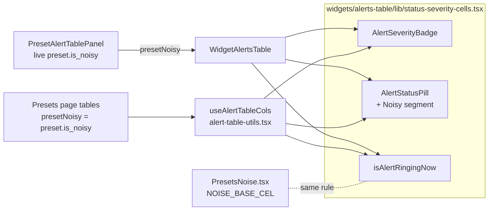

# Alert Table readability: status, severity and noise as text

Date: 2026-11-15
Repo: `keep-ui` only (no gateway, event-handler, workflows or migration change)
Base: `origin/dev` at `fbb5610f`
Mock: "Alert Table Readability" canvas, reviewed in the brainstorming session (Option A chosen; not committed)

## Intro

### The problem

An on-call engineer looking at an alert table has to decode three small marks to know what a row means:

- **Severity** is a 4px colored line. Critical is a red line, high an orange line; there is no word.
- **Status** is a 16–20px icon. Its name exists only as a hover tooltip. Suppressed and pending draw the identical gray icon, so they cannot be told apart without hovering.
- **Noise** is shown two different ways: the dashboard widget swaps the firing icon for a speaker, while the presets page shows a separate bare red bell column, and only when `NOISY_ALERTS_ENABLED` is on.

So "noisy firing critical" and "quiet resolved info" differ only by color and icon shape. Anyone who has not memorized the legend has to hover cell by cell, which is exactly what triage at a glance cannot afford.

Where it happens today:

| Surface | File | Severity | Status | Noise |
|---|---|---|---|---|
| Dashboard Alert Table widget | `src/app/(keep)/dashboard/widget-types/preset/widget-alerts-table.tsx` | `SeverityBorderIcon` (4×16px line) | `Icon` from `getStatusIcon` / `getStatusColor`, no header | speaker icon when `isNoisy && firing`, ignores the flag |
| Presets page table | `src/widgets/alerts-table/lib/alert-table-utils.tsx` | `TableSeverityCell` (full-height row-edge strip, `severity` column) | 36px icon cell with tooltip, `status` column | `noise` column, bell icons, gated by `NOISY_ALERTS_ENABLED` |

### Why we got this assignment

Filed as a user story on behalf of on-call engineers who triage from dashboard Alert Table widgets and the presets page: "I want alert status, severity and noisy/clear state to be instantly readable without memorizing the legend, so that I can triage alerts at a glance instead of hovering over tiny icons."

**To confirm:** who raised the story and what put it on the board now (an incident, customer feedback, a roadmap item).

## Requirements

### Functional requirements

Severity cell (dashboard widget and presets page):

1. Every row with a severity shows the severity **word** in a badge: `Critical`, `High`, `Warning`, `Low`, `Info`, `Error`.
2. The badge is a light tint of today's severity color, dark text in the same hue, and a small solid square of the base color. The colors come from today's palette (critical red, high/error orange, warning yellow, low emerald, info blue).
3. Numeric severities are mapped through `severityMapping` before display, as the widget does today.
4. An unknown severity string renders as its capitalized raw value in a neutral gray badge (not the emerald fallback used today). A missing severity renders an empty cell.
5. On the presets page the full-height row-edge strip stays, inside the same `severity` cell, with the badge beside it.

Status cell (dashboard widget and presets page):

6. Every row shows a status **pill**: today's status icon in today's status color, plus the capitalized status word (`Firing`, `Acknowledged`, `Resolved`, `Suppressed`, `Pending`; any other value capitalized as-is, e.g. `Merged`).
7. The pill outline and text are neutral, so it reads as a different kind of element from the colored severity badge.
8. The icon is never the only cue: it is `aria-hidden`, and the word is the pill's accessible name.
9. The widget no longer swaps the firing icon for a speaker when `isNoisy` is set.

Noise ("Rings now"):

10. A dark **Noisy** segment (bell icon + the word "Noisy") is attached to the right of the status pill exactly when the row is one that makes the preset's alarm ring:
    `presetNoisy && status === "firing" && severity === "critical" && !deleted`
    This mirrors `NOISE_BASE_CEL` in `src/features/presets/custom-preset-links/ui/PresetsNoise.tsx`, the condition the sound is armed on.
11. The rule is the same in both surfaces. It does not read `NOISY_ALERTS_ENABLED` (the sound does not either) and it does not read the alert's own `isNoisy` field.
12. The dashboard widget decides `presetNoisy` from the **live** preset (`PresetAlertTablePanel` already receives it re-resolved from `useDashboardPreset()`), not from the snapshot stored in the widget config. Un-flagging a preset removes the segment, just as it silences the sound.
13. Places that render the presets table outside a preset (for example the incident alerts tab, which passes `presetNoisy: false`) show no Noisy segment.

Columns and layout:

14. Presets page: the `severity` column gets the header "Severity" and a fixed width (~96px). The `status` column gets the header "Status" and a fixed width (~160px, the widest pill being Critical + Firing + Noisy or "Acknowledged"). The `noise` column is removed.
15. Presets page: column ids `severity` and `status` are kept, so each user's saved column order, visibility and pinning (localStorage) keeps working. `noise` is removed from both `leftPinnedColumns` lists.
16. Presets page: status grouping, and the default `noise` sort sent to the server when `NOISY_ALERTS_ENABLED` is on, behave exactly as today (the sort is a server field name and does not need the column).
17. Dashboard widget: the `severity` and `status` columns get the headers "Severity" and "Status"; the cells size to the badge and pill (`min-content`). Name and Description absorb the extra width, and the widget scrolls horizontally sooner than today (about 190px earlier).

Legend:

18. No separate legend is added. The words carry the meaning, so the "legend or tooltip" acceptance criterion is satisfied as "verified unnecessary once text is present".

### Non-functional requirements

- **Shared rendering:** severity badge, status pill, Noisy segment and the "rings now" predicate are defined once and imported by both surfaces. No copy of the markup in either table.
- **Backward compatibility:** no API, schema or config change. Saved column order, visibility and sizing in localStorage remain valid (same column ids). Fixed-width meta classes override any stale stored size for `severity`/`status`.
- **Scope containment:** `SeverityBorderIcon`, `TableSeverityCell`, `getStatusIcon` and `getStatusColor` keep their current behavior, because the incident list, incidents table, Incident Table widget and alert facets also use them.
- **Accessibility:** badge and pill text meets 4.5:1 contrast on its background (800-shade text on 100-shade tints, gray-800 on white). Noisy is distinguished by word and shape, not by red. Icons are `aria-hidden`.
- **Dark mode:** keep-ui dark mode is a global `invert() hue-rotate() contrast()` filter on `html.workaround-dark`. Components use light Tailwind colors only, with no `dark:` variants, and must stay legible under that filter.
- **Performance:** purely presentational. No new requests: `presetNoisy` comes from data the tables already have. Cost per row is a few spans.
- **Quality gates:** `next build` ignores type and lint errors, so `npm run typecheck` and `npm run lint` must pass on the changed files, plus `npm test`.
- **Tests:** new unit tests cover the rendering and the rule (see Proposed Implementation → Testing). Existing tests pass, updated only where they asserted the old icon-only markup.

## Proposed Implementation



### Visual treatment

**Option A: Badges, noise merged into the status pill**
Tinted severity badge with the word, neutral status pill with the colored icon and the word, and a dark "Noisy" segment fused onto the pill.

Trade-offs:
- Pros: strongest at-a-glance read, including from across a room. Severity and status look like two different kinds of thing. Noise is readable by word and shape, and the presets page drops a column.
- Cons: the widest option. The widget needs about 190px more before it scrolls sideways.
- Complexity / risk / cost / time: low.

**Option B: Plain words beside today's marks**
Keep the line and the icon, and add a colored severity word and a plain status word. "Noisy" is a light-red tag, in its own column on the presets page.

Trade-offs:
- Pros: smallest visual change, closest to today.
- Cons: about the same width as A, but quieter and less scannable. Noise keeps a separate column.
- Complexity / risk / cost / time: low.

**Option C: Compact codes for narrow widgets**
`CRIT/HIGH/WARN/LOW/INFO` and `FIRE/ACK/OK/SUPP/PEND` chips.

Trade-offs:
- Pros: wins back about 70 of A's extra 190px.
- Cons: the codes are a mini-legend of their own, which is the very thing the story removes. It would also be a second visual variant to maintain.
- Complexity / risk / cost / time: medium (two variants, container-width switching).

**Recommendation:** Option A on both surfaces (chosen in the mock review). The width cost goes to Name and Description, which already truncate. C is not built unless real dashboards turn out to run tiles too narrow for A.

### Noise rule

**Option A: "Rings now"**
Noisy appears exactly on rows that make the alarm sound: noisy preset + firing + critical + not deleted.

Trade-offs:
- Pros: the word matches what the engineer hears. One rule everywhere. It agrees with `PresetsNoise.tsx`.
- Cons: alerts flagged only with `isNoisy` get no marker anywhere. `NOISY_ALERTS_ENABLED` no longer gates any visible marker. A new client-side predicate mirrors a CEL string, so the two must be changed together.
- Complexity / risk / cost / time: low. The widget needs one new prop.

**Option B: "Flagged noisy"**
Unify today's presets-table rule: firing && (`isNoisy` || preset noisy), behind `NOISY_ALERTS_ENABLED`.

Trade-offs:
- Pros: closest to today's presets page.
- Cons: it labels rows that never ring (any non-critical firing alert in a noisy preset). The widget's marker disappears wherever the flag is off, which is the default.
- Complexity / risk / cost / time: low.

**Recommendation:** Option A ("Rings now"), chosen in the brainstorming session. To keep the predicate and `NOISE_BASE_CEL` from drifting, the predicate's JSDoc names `PresetsNoise.tsx`, and its test cases spell out the same four conditions.

### Shared component location and API

**Option A: New `widgets/alerts-table/lib/status-severity-cells.tsx`**
The path suggested in the story. The presets table already lives in `widgets/alerts-table`, and the dashboard widget already imports `DEFAULT_COLS` from `widgets/alerts-table/lib`.

**Option B: `entities/alerts/ui`**
More FSD-pure (domain display), and reusable by features as well as widgets.

**Option C: Change `SeverityBorderIcon` / `getStatusIcon` in place**
Ruled out. It would also change the incident list, the incidents table, the Incident Table widget and the facets.

Trade-offs (A vs B): both are importable by both consumers. A matches the story and keeps the change inside the alerts-table slice. B only pays off once incident surfaces adopt the components, which is out of scope.

**Recommendation:** Option A. API sketch:

```tsx
export function isAlertRingingNow(
  alert: Pick<AlertDto, "status" | "severity" | "deleted">,
  presetNoisy: boolean
): boolean;

export function AlertSeverityBadge(props: {
  severity: UISeverity | string | number | undefined;
  size?: "xs" | "sm";
}): JSX.Element | null;

export function AlertStatusPill(props: {
  status: string;
  noisy?: boolean;
  size?: "xs" | "sm";
}): JSX.Element;
```

- `size="xs"` is the dashboard widget's 12px rows; `size="sm"` is the presets table.
- The colors reuse `getSeverityBgClassName` for the square. Tint and text classes come from `getSeverityLabelClassName` plus a new text-shade helper in the same file, or an extension of `severity-utils.ts`; the builder picks one.
- The icon and color reuse `getStatusIcon(status)` (no `isNoisy` argument) and `getStatusColor(status)`.

### Presets page columns

**Option A: Reuse the `severity` and `status` column ids, widen them, drop `noise`**
In `alert-table-utils.tsx`, the `severity` display column renders `TableSeverityCell` and `AlertSeverityBadge`. Its meta changes from `w-1 !p-0` to a fixed width, with a "Severity" header. The `status` column renders `AlertStatusPill` with `noisy={isAlertRingingNow(row, presetNoisy)}`, a "Status" header and a fixed ~160px width. The `noise` column definition is deleted, and the 36px special case in `alert-table-headers.tsx` (`dragStyle`) is updated to the new width.

**Option B: Add new column ids next to the old ones**
Leaves the old icon columns in place.

Trade-offs:
- A: saved user layouts keep working, and there are no duplicate columns. The pinned left block gets wider.
- B: users' saved column orders don't contain the new ids, so the new columns land in unpredictable places. It also leaves two status columns, or needs a localStorage migration.

**Recommendation:** Option A. Leave the flag-gated default `noise` sort in `alert-table.tsx` and `alert-table-server-side.tsx` untouched (see Out of scope). Remove `"noise"` from both `leftPinnedColumns` arrays.

### Dashboard widget

Only one viable approach. `PresetAlertTablePanel` passes `presetNoisy={!!preset?.is_noisy}` (the live preset it already holds) to `WidgetAlertsTable`. There, `columnsMeta.severity` and `columnsMeta.status` render `AlertSeverityBadge size="xs"` and `AlertStatusPill size="xs"` with `renderHeader` returning "Severity" / "Status" (still honouring `columnRenameMapping` if present). The `getStatusIcon(alert.status, alert.isNoisy)` call goes away.

**Recommendation:** as described. The alternatives (reading the widget's stored preset snapshot, or calling `usePresets` inside the table) are rejected. The snapshot goes stale when a preset is un-flagged, and the parent already has the live value.

### Testing

New `src/widgets/alerts-table/lib/__tests__/status-severity-cells.test.tsx`:

- `isAlertRingingNow`: true only for `presetNoisy && firing && critical && !deleted`. Cases flip each condition, including numeric critical severity, mixed-case status, and `isNoisy: true` on a non-noisy preset → false.
- `AlertSeverityBadge`: renders the word for each `UISeverity`, maps a numeric severity, renders the raw value for an unknown string, renders nothing for undefined.
- `AlertStatusPill`: renders the word for each status, the icon is `aria-hidden`, and the Noisy segment shows only with `noisy`.

Updated or added:

- `widget-alerts-table.test.tsx`: words visible. Noisy only on a critical firing row when `presetNoisy` is true, absent when false.
- A columns test for `useAlertTableCols` (or the existing presets-table tests): Severity and Status headers render words, no `noise` column, Noisy follows `presetNoisy`.

Gates: `npx jest` on the touched tests, `npm run typecheck`, and `npm run lint` on the changed files.

## Summary

- **Chosen approach:** Option A from the mock, on both the dashboard Alert Table widget and the presets-page table. A tinted severity badge with its word, and a neutral status pill with the colored icon and the word. A dark "Noisy" segment is fused onto the pill only on rows that make the alarm ring. All of it comes from one new shared file, `widgets/alerts-table/lib/status-severity-cells.tsx`.
- **Key decisions:**
  - "Noisy" means "rings now" (noisy preset + firing + critical + not deleted), matching `PresetsNoise.tsx`. It ignores `isNoisy` and `NOISY_ALERTS_ENABLED`.
  - Existing `severity`/`status` column ids are reused and `noise` is removed, so saved layouts survive.
  - Shared icon and severity primitives stay unchanged, so incident surfaces are unaffected.
  - The widget reads the live preset's `is_noisy`.
  - No legend, because the words make it unnecessary.
- **Out of scope / follow-ups:**
  - Incident list, incidents table, Incident Table widget and facets adopting the same components.
  - Whether to retire `NOISY_ALERTS_ENABLED`, which after this change only drives the default `noise` sort and nothing visible. That sort sends `sortBy: "noise"` to the gateway, which most likely matches no real field; worth checking separately.
  - Whether `isNoisy` on alerts still has a purpose in the UI.
  - Compact codes for very narrow widgets (Option C), only if real dashboards need it.
  - The `low` severity green and the `resolved` status green share a hue. The words now disambiguate them, so the palette is unchanged.
