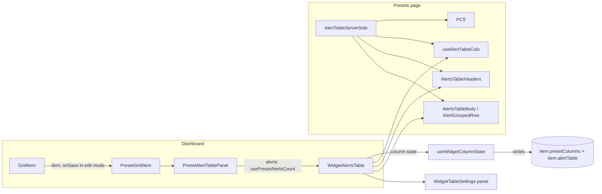

# Alert Table widget customization (columns, widths, names, grouping)

Status: draft for review, 2026-11-15. Base: `origin/dev` at `fbb5610f`. Repo: keep-ui only.

## Intro

### The problem

On a dashboard, the Alert Table widget shows a preset's latest alerts in a fixed, hand-built grid (`src/app/(keep)/dashboard/widget-types/preset/widget-alerts-table.tsx`). The editor can pick which columns appear (the Columns picker in the widget form). They cannot:

- reorder columns, resize them, or rename them for this widget;
- group the alerts, for example by the incident they belong to.

The full alerts table on the presets page can do all of this. The two tables share no code for it.

There is also a hidden bug. The widget is meant to follow the preset's column order and names, but it reads them from an old, unscoped browser-storage key (`column-order-<preset>`, `column-rename-mapping-<preset>`). The presets page no longer writes there. A preset's column layout on the presets page is per user:
- custom presets use the server's `UserPresetColumnConfig` (one row per tenant, preset and **user email**);
- static presets use per-user browser keys (`column-order-<email>-<preset>`).

So no shared "preset column order" exists to follow. Each viewer of the widget sees whatever their own browser happens to hold, which is often stale.

### Why we got this assignment

A client asked to see dashboard alerts grouped by incident, so operators can tell at a glance which alerts are already handled under an incident and which are not. The story generalises this into full widget customization (reorder, resize, show/hide, rename, group by any column), reusing the presets-page table rather than writing the logic a third time.

## Requirements

### Decisions already made (with the requester, 2026-11-15)

- **Who can change it, and who sees it.** Customization happens only while the dashboard is in edit mode. Changes are saved with the dashboard's Save, and every viewer sees the same table. In view mode there are no column controls. Viewers can expand and collapse groups, but that is not saved. (Per-viewer tweaks were considered and rejected.)
- **What grouping covers.** Grouping applies to the alerts the widget loads: the last N alerts from the "Last alerts count to display" setting. Showing every incident in the preset (server-side grouping) was rejected for this story.
- **Alerts with no value.** Alerts whose group-by field is empty go into one group labelled "No <column name>" ("No incident" for incident). It sits at the **top by default**. The editor can switch it to the bottom per widget.
- **How it's built.** The widget is assembled from the presets-page table's parts, with a swappable settings store (Proposed Implementation, area 1).
- **Mock.** The approved mock is kept in the brainstorm folder (`keep-namespace/.superpowers/brainstorm/70277-1794775052/content/`: `alert-table-widget-v2.html`, `group-by-incident.html`, `group-by-incident-setup.html`).

### Functional requirements

**Editing (dashboard in edit mode only)**

1. The widget header row shows a ⚙ button next to "Go to preset". It opens a "Table settings" panel with:
   - the column list, showing each column's checkbox (visible/hidden), drag handle (reorder) and rename action;
   - a search box that adds any alert field as a column;
   - a **Group by** select: None, Incident, then Service, Host, Application, Assignee, Source, Severity, Status, then "Any other field…" (search);
   - when Group by is set, **"Alerts with no value: Top / Bottom"** (default Top);
   - **Reset to defaults**.
2. Hovering a column header shows a drag handle (reorder by drag and drop), a resize edge (drag to resize, double-click to auto-fit) and a column menu with: Rename, Group by / Ungroup, Auto-fit width, Reset width, Move left, Move right, Hide column. Sort and the time/list display formats are **not** offered in the widget.
3. Every change shows immediately in the widget and is kept in the dashboard's unsaved edit state. Save dashboard persists it; Cancel discards it, as for any other widget edit.
4. The widget form (Add widget / Edit widget) gains the same **Group by** select and, when it is set, the **Alerts with no value** setting. The existing Columns picker stays and controls the same visibility setting as the ⚙ panel.
5. In edit mode the widget's navigation is off: "Go to preset" and incident links don't navigate, and rows aren't clickable. This matches the current rule that panel content must not navigate while editing.

**Viewing**

6. In view mode there is no ⚙ button and no header controls. The table shows the saved columns, order, names, widths and grouping.
7. Group rows can be expanded and collapsed by clicking them, plus Expand all / Collapse all. Groups start expanded, as on the presets page. This state is not saved and resets on reload.
8. A grouped widget shows a chip, "Grouped by <column>", above the table. In edit mode the chip has a ✕ that clears grouping. In view mode it is label-only.

**Grouping display**

9. Groups are ordered by their newest alert (the order the alerts are loaded in, newest first). The "No <column>" group is pinned to the top or bottom per requirement 1.
10. Each group header shows the group value and the number of alerts in it.
11. Grouping by **Incident**:
    - the header shows the incident's name, linked to `/incidents/<id>` (the link is inactive in edit mode), its status, and "<x> shown · <y> in incident", where y is the incident's own `alerts_count`;
    - an alert that belongs to several incidents goes into one combined group, which is how the presets page already groups. Its header links each incident name separately, shows no status badge, and reads "<x> shown · in <N> incidents";
    - alerts with no incident go into "No incident", styled plainer than a real incident (no link, no status);
    - grouping by incident works whether or not the Incident column is visible.
12. Only one column can be grouped at a time, the same rule as the presets page.

**Fallback and reset**

13. A widget with no saved customization of a setting falls back as follows:

    | Setting | Falls back to |
    |---|---|
    | Visible columns | the widget's `presetColumns` (existing Columns picker), else the current widget defaults: severity, status, source, name, description, lastReceived |
    | Column order | the default order: `DEFAULT_COLS` order for the ids it lists, then the remaining columns. The same for every viewer |
    | Column names | default names (no renames) |
    | Widths | each column's default width |
    | Grouping | none |

    Each setting falls back independently. For example, renaming one column doesn't freeze the order.
14. "Reset to defaults" clears all of this widget's column and grouping settings (`presetColumns` and `alertTable`), so the widget falls back again.
    - The panel shows "Customized for this widget" and enables Reset only when `alertTable` holds a setting, or the visible columns differ from the widget defaults (compared as a set, after resolving legacy ids).
    - The form's Columns picker always saves `presetColumns`. A widget added with the default columns is therefore not customized. One added with other columns is, and Reset brings back the widget defaults, not the form's pick.
15. The checkbox, row-menu and noise columns never appear in the widget.
    - The severity, status and source icon columns can still be shown or hidden, because existing widgets may already hide them through the form picker.
    - When visible, they are pinned to the left. They have no header menu, as on the presets page.
    - In the ⚙ list they have a checkbox but no drag handle and no rename.

**Robustness**

16. A configured column that none of the loaded alerts has renders empty cells. It never crashes and never disappears from the settings.
17. A saved setting naming a column the widget can't build (an unknown id, or one of the excluded columns in requirement 15) is ignored.
18. Existing dashboards keep working with no migration. Widgets saved before this change render their saved `presetColumns`. Their order is now the default order, the same for every viewer (requirement 13). It no longer comes from the stale per-browser key, which fixes the bug in the Intro. An editor who wants another order sets it on the widget.

**Compact sizes**

19. If the columns don't fit, the table scrolls sideways instead of squeezing columns below their minimum width.
20. In edit mode on a narrow widget (builder's threshold: 320px of table width, `NARROW_WIDGET_PX`), header controls are hidden and the ⚙ panel is the way to change columns. The grouping chip stays visible at every size.

### Non-functional requirements

- **No backend change.** The gateway stores `dashboard_config` as free-form JSON (`keep-api-gateway src/models/db/dashboard.py:13`, `src/routes/dashboard.py:34`), so new widget fields need no gateway or migration change. The widget keeps loading data with `usePresetAlertsCount` (`POST /alerts/query`, last N alerts, newest first, refreshed every 30s). That endpoint already returns each alert's incidents (`incident` = joined ids, `incident_dto` = name, status, severity, `alerts_count`).
- **Network.** No new requests. The widget doesn't read the presets page's per-user column config.
- **Presets page must not regress.** The shared header, body and grouped-row components keep their current behaviour on the presets page by default. The one intended change there is the empty-label fix in area 5: a grouped column with no value shows "No <column>" instead of "undefined" or "null".
- **Saving.** Column resize saves once when the drag ends (TanStack `columnResizeMode: "onEnd"`), not on every pixel.
- **Dark mode.** keep-ui dark mode is a global CSS invert filter, so the widget is styled for light mode only.
- **Type and lint safety.** `next build` ignores type and lint errors, so `npm run typecheck` and `npm run lint` must pass on changed files.
- **Tests.** Unit tests cover ordering, visibility, renaming, widths and grouping persistence (round trip through the widget config), the per-setting fallback, reset, "No <column>" placement, the incident group header, edit-mode-only controls, and the shared components still behaving the same on the presets page.

## Proposed Implementation

### How it fits together



### 1. Overall rendering approach

**Option A: Shared table parts plus a swappable settings store**

The widget builds its own small TanStack table from the presets-page parts:

- `useAlertTableCols` for column definitions, which already handles incidents and grouping values (`src/widgets/alerts-table/lib/alert-table-utils.tsx:225`);
- `AlertsTableHeaders` for drag, resize and the column menu (`src/widgets/alerts-table/ui/alert-table-headers.tsx`);
- `AlertsTableBody` and `AlertGroupedRow` for rows and group rows.

These take their state as props, so the widget feeds them from a widget store.

Trade-offs:
- Pros: one implementation of drag, resize, rename and grouping. Fixes in either place reach both tables. The widget's data path is untouched.
- Cons: touches components the presets page depends on, which needs regression tests.
- Complexity / risk / cost / time: medium. Most of the risk is in the header and grouped-row changes.

**Option B: Mount `AlertTableServerSide` in a compact mode**

Trade-offs:
- Pros: the widget gets every presets-page feature in one move.
- Cons:
  - The component is 993 lines of page-only behaviour: the facets panel, a date picker that writes URL query params (`useTimeframeState({ enableQueryParams: true })`), its own data fetch through `onQueryChange`, row selection and the action tray, the alert sidebar, pagination, and the "create incident from last alerts" URL handler.
  - Each part needs a switch, every widget carries the weight, and the date picker would rewrite the dashboard's URL.
- Complexity / risk / cost / time: high, with regression risk on the main alerts page.

**Recommendation:** Option A, chosen with the requester. Option B was ruled out for the weight and URL side effects. A third option, extending the current hand-built grid, was ruled out because it writes the logic a third time, which the story forbids.

### 2. Where the widget's settings live

**Option A: Keep `presetColumns` for visibility, and add one optional `alertTable` object for the rest**

```ts
interface WidgetData {
  /** Visible column ids, written by the form's Columns picker. Already stored in saved dashboards but undeclared (read with `as any`); now declared. */
  presetColumns?: string[];
  alertTable?: AlertTableWidgetConfig;
}

/** Every key is optional; an absent key means "fall back" (requirement 13). */
interface AlertTableWidgetConfig {
  columnOrder?: string[];
  columnRenameMapping?: Record<string, string>;
  columnSizing?: Record<string, number>;
  /** Column id, e.g. "incident" or "service"; absent or null means not grouped. */
  groupBy?: string | null;
  /** Where the "No <column>" group goes; default "top". */
  emptyGroupPosition?: "top" | "bottom";
}
```

Trade-offs:
- Pros:
  - No migration, because `presetColumns` keeps its meaning.
  - Each setting falls back independently.
  - "Reset to defaults" just deletes `alertTable` and `presetColumns`.
  - Copying the widget's JSON copies everything.
- Cons: visibility lives outside the new object, so readers must know both fields.
- Complexity / risk / cost / time: low.

**Option B: Move everything, including visibility, into `alertTable` and migrate `presetColumns` on read**

Trade-offs:
- Pros: one object holds all of it.
- Cons:
  - Two fields mean the same thing until every dashboard is re-saved.
  - The form's picker has to change what it writes.
- Complexity / risk / cost / time: low to medium.

**Recommendation:** Option A. It needs no migration and keeps the existing form field working unchanged.

### 3. Column-state store (the swappable part)

**Option A: A `useWidgetColumnState(item, onChange)` hook returning the same shape the shared components already take**

`AlertTableServerSide` already gets `columnOrder`, `columnVisibility`, `columnRenameMapping` and their setters from `usePresetColumnState` (`src/entities/presets/model/usePresetColumnState.ts`). It passes them to `AlertsTableHeaders` as props, with `grouping` and `columnSizing` kept in per-user local storage.

A new widget hook returns that same set:

- `columnOrder`, `columnVisibility`, `columnRenameMapping`, `columnSizing`, `grouping`, `emptyGroupPosition`, each with a setter.
- Reads come from `item.presetColumns` and `item.alertTable`. Missing values fall back per requirement 13.
- Order and names fall back to the widget defaults (requirement 13). The widget never reads `usePresetColumnState`, because that layout is per user (see the implementation ruling below).
- Setters build the updated `WidgetData` and call `onChange(updatedItem)`.

Trade-offs:
- Pros:
  - The presets page is unchanged.
  - The widget's fallback is the same for every viewer, which fixes the stale-key bug.
- Cons: the widget hook re-states some of `AlertTableServerSide`'s glue, about 20 lines of state wiring.
- Complexity / risk / cost / time: low.

**Option B: A formal `ColumnStateSource` interface, with both `AlertTableServerSide` and the widget refactored onto it**

Trade-offs:
- Pros: a single abstraction.
- Cons: refactors the presets page's state handling for no user-visible gain, and widens the regression surface.
- Complexity / risk / cost / time: medium.

**Recommendation:** Option A. The shared components are already prop-driven, so a second hook producing the same props is all the widget needs.

### 4. Edit mode, inert and the save path

Two facts on dev shape this:

- `GridItem` makes widget bodies `inert` in edit mode. Only the count panel and generic metrics are exempt (`src/app/(keep)/dashboard/GridItem.tsx:74-78`). As it stands, every in-widget control would be dead in exactly the mode where it must work.
- Generic metrics already push in-widget edits into the dashboard's edit state with `onEdit={isEditMode ? onSave : setUpdatedItem}` (`GridItem.tsx:92`). `onSave` is the dashboard's `handleSaveEdit` (`src/app/(keep)/dashboard/[id]/dashboard.tsx:178`).

**Option A: Exempt the Alert Table widget from `inert`, pass `onSave` down, and switch off navigation inside the widget in edit mode**

- `PresetGridItem` and `PresetAlertTablePanel` receive `onSave`.
- `useWidgetColumnState` calls it on every change.
- In edit mode the panel disables "Go to preset" and incident links, and passes no row-click handler.

Trade-offs:
- Pros: follows the generic-metrics precedent, and Save/Cancel and the edit snapshot work unchanged.
- Cons: the navigation rule moves into the widget instead of coming free from `inert`, so it needs a test.
- Complexity / risk / cost / time: low.

**Option B: Make only the ⚙ panel interactive and keep the table body inert**

Trade-offs:
- Pros: the navigation rule stays with `inert`.
- Cons: header drag, resize and the column menu (requirement 2, part of the approved mock) can't work.
- Complexity / risk / cost / time: low, but it drops a requirement.

**Recommendation:** Option A.

Other things the builder must check:

- `handleSaveEdit` also calls `closeModal()` and `applyEditedItemToLayout`. Confirm that a config-only change leaves the widget's layout alone and doesn't flicker the modal.
- The grid's drag handle is `.grid-item__widget` (title and handle only), so dnd-kit header drags inside the widget don't move the widget.

### 5. Changes to the shared presets-table components

**`AlertsTableHeaders` / `DraggableHeaderCell`** (`alert-table-headers.tsx`)

- Add optional props, with defaults that keep today's behaviour:
  - `interactive` (default true): when false, no drag handle, resize edge or menu;
  - `showSortItems`, `showFormatItems` (default true).
- **The fix the widget depends on:** today Rename and Group by sit inside the `column.getCanSort() && (...)` block (lines 354-417). With sorting disabled in the widget they would vanish.
  - They render when `column.getCanSort() || !showSortItems`. On the presets page (`showSortItems` true) the menu stays exactly as today; `noise` and `extraPayload` don't gain a Rename item.
- `isRightmostColumn` assumes `alertMenu` is the last column and throws with a single visible column. It becomes "the last visible column that isn't `alertMenu`", guarded for one column.

**`AlertsTableBody`**

- Make `onRowClick` optional.
- Add a way to render at the widget's density (today `text-xs`, about 28px rows) whatever the user's global row-style preference.
- Add `rowAppearance?: "default" | "plain"`. `getRowClassName` falls back to `bg-white`, which would cover the widget's threshold tint, and adds `cursor-pointer` and an orange hover. "plain" rows are transparent, with no pointer cursor and no hover.
- Add `selectable?: boolean` (default true). When false, rows render without `SelectableGroup`: its `globalMouse` drag-select must not run across a dashboard.

**`AlertGroupedRow`** (`alert-grouped-row.tsx:47-66`)

- **Empty label (shared, both tables):** treat `null`, `undefined`, `""`, `"undefined"` and `"null"` as empty, and label the group "No <column display name>". Today only incident has this ("No Incidents"); other columns print "undefined".
- **Incident details (widget only, behind a prop):** status badge, the incident name linked to `/incidents/<id>` (click must not toggle the group), and "<x> shown · <y> in incident" from `incident_dto[].alerts_count`.
- **Empty-group placement (widget only):** reorder the top-level grouped rows so the empty group comes first or last. The builder decides whether this is a row-model wrapper passed to the widget's `useReactTable` or a reorder before rendering.

**Recommendation:** make these changes as above. The alternative, copying the three components into the widget, is ruled out by the story.

### 6. Column definitions and data in the widget

- Call `useAlertTableCols` with:
  - `isCheckboxDisplayed: false`, `isMenuDisplayed: false`;
  - a widget-scoped name (builder-check 3). `presetNoisy` is not passed: it only changes the `noise` column, which the widget never shows (requirement 15);
  - `additionalColsToGenerate` = union of (a) the field keys of the loaded alerts, (b) the configured visible columns, (c) the group-by field, and (d) `incident`.
- (a) is derived inline today in `src/app/(keep)/alerts/[id]/ui/alert-table-tab-panel-server-side.tsx:59-85`. Move it into a shared helper both callers use.
- (b) and (c) guarantee requirement 16: a column nobody has still gets a definition and renders empty.
- `useReactTable` in the widget: `enableSorting: false`, no pagination, `enableGrouping: true`, `columnResizeMode: "onEnd"`, left pinning for severity, status and source.
- Data: unchanged (`usePresetAlertsCount(filterCel, false, countOfLastAlerts, 0, 30000)`). The server's default order (timestamp descending, `keep-api-gateway src/repositories/alerts.py:690`) gives the newest-first group order in requirement 9.

### 7. ⚙ Table settings panel and form fields

**Option A: A new widget-only `WidgetTableSettings` popover, reusing the field-options logic from the presets page**

- The panel lays out the controls in requirement 1.
- Column reorder in the list uses dnd-kit's vertical sortable list (dnd-kit is already a dependency).
- The list of addable fields comes from a small shared hook, which pulls out the options logic in `ColumnSelection.tsx`: table columns, the common enrichment fields and search. The presets page's `ColumnSelection` and the widget panel both use it. The widget's search also uses `useFacetPotentialFields("alerts")`, as the form's picker does today.
- The Group by select is one component, used both in the panel and in the widget form.

Trade-offs:
- Pros:
  - Fits the widget: it is immediate, edit-mode only, has grouping and has no Apply step.
  - Doesn't drag in the presets page's user-wide Theme, Row style, Action tray and Font size tabs.
- Cons: the checkbox list markup is similar to `ColumnSelection`'s, though built separately.
- Complexity / risk / cost / time: medium. This panel is most of the new UI.

**Option B: Reuse `SettingsSelection` / `ColumnSelection` by injecting the widget's state**

Trade-offs:
- Pros: less new markup.
- Cons:
  - `ColumnSelection` is tied to `usePresetColumnState` and works as "edit, then Apply" with presets-page reset hooks (facets, grouping).
  - `SettingsSelection`'s other tabs are user-wide preferences that make no sense per widget.
  - Neither has reorder, rename or Group by.
- Complexity / risk / cost / time: medium, with more presets-page risk.

**Recommendation:** Option A.

**Form hint.** When Group by is set and "Last alerts count" is under 10, the form shows a hint: "Grouping works best with 20 or more alerts". The default count stays 5, and nothing changes the count automatically.

### 8. Narrow widgets

Measure the widget's width (a container query or `ResizeObserver`). Below the builder's threshold, render the headers with `interactive={false}` even in edit mode. The table container keeps `overflow-x-auto`, and every column keeps its minimum width (requirements 19 and 20).

### 9. Delivery split (if the 8 points are split)

- **Part (a):**
  - the widget renders through the shared parts (areas 1, 5 and 6);
  - the order and name fallback is the shared default (area 3's fallback);
  - show/hide still uses the existing form picker.
  - This part ships the bug fix and the shared-component groundwork, with no new settings.
- **Part (b):**
  - the `alertTable` settings and the widget store (areas 2 and 3);
  - edit-mode controls and the `inert` exemption (area 4);
  - the ⚙ panel and form fields (area 7);
  - grouping with "No <column>" placement and incident details;
  - narrow widgets (area 8).

**Decision (2026-11-15):** one branch and one delivery, demoed live as it is built. The split above stays only as a fallback if review needs smaller PRs.

### 10. Coordination with other in-flight work

- **Alert Table readability** (local branch `feat/alert-table-readability`, spec commit `28e7e798`, not merged):
  - It edits this widget's hand-built `columnsMeta` (severity and status cells) and threads `presetNoisy` into it. This story replaces that renderer with `useAlertTableCols`, where readability's shared `status-severity-cells.tsx` also lands.
  - If readability merges first, this story deletes its widget-only cell code and the widget picks the badges up through `useAlertTableCols`.
  - As built, the widget passes no `presetNoisy` (review of `9216a4f7`): nothing on its path reads it. The noisy-preset row work (ui#111) adds what it needs when the two are combined.
  - Either order works. The second to merge rebases.
- **Incident Table widget** (ui#99, open): no overlap. It lists incidents; this story groups alerts.

## Summary

- **Chosen approach:**
  - The dashboard Alert Table widget is rebuilt from the presets-page table's parts (column definitions, headers, body, grouped rows), fed by a new widget settings store.
  - It's customizable in dashboard edit mode only (⚙ panel plus header controls) and saved with the dashboard, so all viewers see the same table.
  - It groups by any column, including incident, over the alerts it loads.
  - keep-ui only, no backend change.
- **Key decisions:**
  - **Edit mode only, shared:** it matches the dashboard's existing Save/Cancel model, and viewers can't reshape a shared wall screen.
  - **Grouping covers the loaded alerts:** this keeps it UI-only. Incident headers show "x shown · y in incident" so a partial view is visible as partial.
  - **"No <column>" group, top by default, switchable per widget:** unlinked alerts are what this client acts on, as the count-by widget's "+N alerts not in an incident" already shows.
  - **`presetColumns` keeps meaning visibility, plus an optional `alertTable` object:** no migration, and each setting falls back on its own.
  - **Uncustomized widgets use the default order and names for every viewer:** a preset's presets-page layout is per user, so there is nothing shared to follow. This fixes the stale browser-storage bug.
- **Out of scope / follow-ups:**
  - Sorting and time/list formats in the widget.
  - Per-viewer tweaks.
  - Server-side grouping showing every incident in the preset.
  - Grouping by more than one column.
  - Splitting an alert that belongs to several incidents into each incident's group: it needs grouping by an array value, which the shared grouping doesn't do.
  - Row click or opening the alert sidebar from the widget.
  - Dashboard duplication: there is no duplicate feature in the UI or gateway today. The settings live in the widget's JSON, so any future copy feature carries them.
  - Incident details in the presets page's group headers.

## Builder-check resolutions (2026-11-15, my calls)

1. **Legacy snake_case column ids** (`last_received`, saved via the facet-list picker) are mapped on read to the matching table column (`lastReceived`). This uses the old widget's `getColumnValue` rule (that file is now removed): exact id first, then camelCase for undotted ids, only when that column exists. Order, renames and `groupBy` store the mapped ids from then on.
2. **Fallback is the shared default for every preset** (implementation ruling, 2026-11-15).
   - The demo build found that the "server-side" preset column config (`UserPresetColumnConfig`, `GET/PUT /preset/{id}/column-config`) is **per user**: unique on tenant, preset and user email.
   - Its table is created by no migration in keep-migrations (`origin/dev` or `origin/main`). On a schema built only from those migrations the endpoint returns 500, and the presets page silently falls back to per-user browser storage.
   - Static presets were already per user.
   - So every source of "the preset's column order" is per viewer. An uncustomized widget falls back to the default order and names for all presets, which keeps the decision that every viewer sees the same table.
   - The ticket's "fall back to the preset's column order" can't be met in a way all viewers share. Editors set the order on the widget instead.
3. **Viewer preferences don't reach the widget.**
   - As built (Ruling R10): `alert-table-utils.tsx` is not edited. The widget passes a widget-scoped `presetName` (`dashboard-widget-<i>`), so the preset's stored renames, formats and expanded rows are never read, and wraps its table in `RowStyleOverrideProvider` (from `useAlertRowStyle`), so every reader of the row-style preference sees "default".
   - The widget passes it and supplies its own header labels. Its time columns render as "time ago", as today.
   - This is the only change to `alert-table-utils.tsx`, and it is additive.
4. **One "No <column>" group.** TanStack keys groups by the value's string form, so `null`, `undefined` and `""` would make three groups. The widget wraps its columns' grouping values so every empty value becomes one key. The presets page keeps its grouping and only gets the label fix.
5. **Several changes at once.** `handleSaveEdit` replaces the whole widget. Multi-key changes (Reset, hide-and-reorder) go out in one `onSave` call, and the store's setters always build on the latest emitted widget, so two changes in one tick both survive.
6. **Tests.** `GridItem.test.tsx` currently asserts that an Alert Table is inert in edit mode. That assertion flips with this change.

## Coexistence with the Count feature (user requirement, 2026-11-15)

The Alert Table and Alert Count widgets already have **Count** (`countBy`: Alerts / Incidents / Other field, the "+N alerts not in an incident" line, and blink). This feature must not collide with it.

- **Separate settings:** the two settings are independent. Row grouping lives in `alertTable.groupBy`, and `countBy` is never read or written.
- **Modal labels:** the new control reads **"Group rows by"**, with **"Rows with no value"** (Top/Bottom) beneath it. Both show only for Alert Table, after Columns. The Count control is unchanged: same place, labels, test ids and tests. The chip above the table reads "Rows grouped by <label>".
- **Shared field list:** the Group rows by shortlist reuses the Count control's field ids and labels (`COUNT_BY_ALERT_FIELD_OPTIONS`): Incident, Alert name, Service, Host, Application, Site, Assignee, then Source and Status.
- **"Shown" counts:** in the widget, group headers count what is shown ("<n> shown", "No incident · <n> shown"). They can't be confused with the Count line's whole-preset numbers.

## What's left to the builder

- The narrow-widget threshold, and how width is measured.
- Whether empty-group placement is a row-model wrapper or a pre-render reorder.
- How the body renders at the widget's density (a prop, or a wrapper class).
- The exact names of the new props and of the shared field-options hook.
- Test layout: the existing `widget-alerts-table.test.tsx`, `preset-alert-table-panel.test.tsx`, `preset-grid-item.test.tsx` and `preset-widget-form.test.tsx` will need rewriting where they assert on the old CSS-grid markup.
