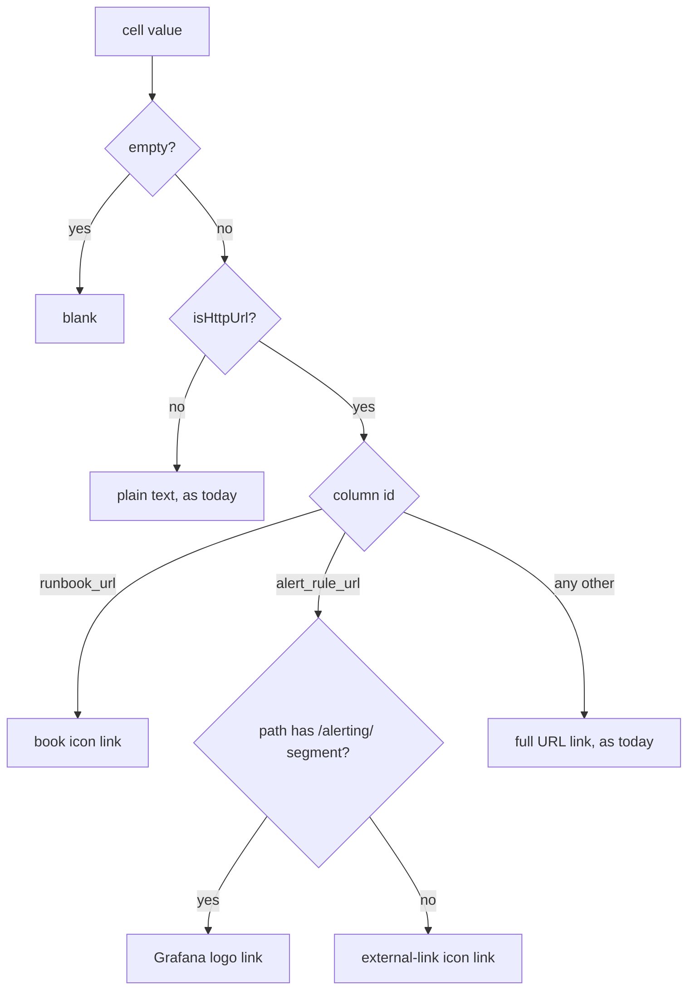

# Alert tables: rule and runbook links as icons

Status: draft, awaiting approval. Base: origin/dev `9e5b877e`. Repo: keep-ui only. Mock: variant A of "Rule & Runbook Links" (artifact `QPk1a8bCxVLiKJyAN6dSSZ`, 2026-11-16).

## Intro

### The problem

Alerts carry two links an on-call engineer needs while triaging:

- `alert_rule_url`: the Grafana alert rule that fired.
- `runbook_url`: the runbook for the alert.

The alert tables print each one as its full URL. A Grafana 12 rule link looks like `https://grafana-olly.com/alerting/grafana/aef3k2pq/view?orgId=1`. The column widens to fit the URL, so the two link columns take about 600px, which is more than the name and description columns together. On a dashboard widget that space is scarce, and the URL text tells the reader nothing the link itself doesn't.

Until ui#110 (merged to dev 2026-11-22), the dashboard Alert Table widget also showed these values as plain, unclickable text. Since #110 the widget builds its columns with the alerts-page `useAlertTableCols`, so on dev both tables render them as clickable full-URL links. The remaining problem is width and readability.

### Why we got this assignment

Users of the presets page and the dashboard Alert Table widget asked for clickable Grafana rule and runbook links that take less room. The team proposed replacing the Grafana link with a clickable Grafana icon. The 2026-11-16 mock offered three variants, and the user chose **variant A (icon only)** on 2026-11-24. The production Grafana is Grafana 12 Enterprise on the custom domain `grafana-olly.com`.

## Requirements

### Functional requirements

1. **Scope of columns.** The change applies to exactly two column ids: `alert_rule_url` and `runbook_url`. Every other URL-valued column (`url`, `generatorURL`, `ticket_url`, `playbook_url`, custom fields) keeps today's full-URL link.
2. **Rule link, Grafana.** When `alert_rule_url` is an http(s) URL whose path has an `alerting` segment (see "Grafana detection"), the cell shows the Grafana logo (`/icons/grafana-icon.png`, 16px) as a link.
3. **Rule link, not Grafana.** When `alert_rule_url` is an http(s) URL that doesn't match, the cell shows a generic external-link icon. A non-Grafana URL never shows the Grafana logo.
4. **Runbook link.** When `runbook_url` is an http(s) URL, the cell shows a book icon as a link.
5. **Opening.** Clicking an icon opens the URL in a new tab (`target="_blank"`, `rel="noopener noreferrer"`). It doesn't trigger the row click, so the alert sidebar doesn't open and widget quick actions don't fire. This matches today's link cell, which calls `stopPropagation`.
6. **Hover and focus.** The icon is a focusable anchor. Hover shows a tooltip with the action and the full URL: "Open alert rule in Grafana", "Open alert rule" or "Open runbook". The anchor's `aria-label` carries the same action text.
7. **Empty value.** `null`, `undefined` or `""` leaves the cell blank, as for every column today.
8. **Not a URL.** A value that isn't a valid http(s) URL (for example `see on-call wiki`, or a URL without a scheme) is shown as plain text, unchanged from today.
9. **Default headers.** The default headers become **"Rule"** and **"Runbook"** instead of "Alert Rule Url" and "Runbook Url". A rename the user sets (`columnRenameMapping`, on the presets page or in the widget) still wins.
10. **Width.** Both columns have a minimum width of 44px, so the column can shrink to the icon plus padding. Auto-fit measures the icon and header, not the URL.
11. **Column behaviour unchanged.** Both columns can still be shown, hidden, reordered, sorted, grouped and renamed on their own, on the presets page and in the widget.
12. **Dashboard edit mode.** In the widget, while the dashboard is in edit mode, the icon stays visible but dimmed and doesn't navigate. This matches how edit mode already turns off row clicks (`preset-alert-table-panel.tsx`).
13. **All tables that use `useAlertTableCols`** get the same cell: the presets page, the dashboard Alert Table widget, incident alerts, the alert history modal and the alert detail tab.

### Non-functional requirements

- **No backend change.** Both fields are already top-level `AlertDto` fields (`src/entities/alerts/model/types.ts:49-50`) in the gateway, event-handler and workflows.
- **No new dependencies.** The Grafana logo already ships at `public/icons/grafana-icon.png`. The book and external-link icons come from `react-icons/md`, which `alert-table-utils.tsx` already imports.
- **Performance.** No new requests. The renderer already parses each value with `new URL()` in `isHttpUrl`; the Grafana check reuses that parse. A widget at its row limit renders the same number of cells as today.
- **Security.** Only `http:`/`https:` URLs become links (the existing `isHttpUrl` guard), so `javascript:` and other schemes stay text. The `noopener noreferrer` behaviour is unchanged.
- **Dark mode.** Keep's dark mode is a page-wide `invert()` filter (`html.workaround-dark`). The Grafana PNG gets inverted exactly like the provider logos in the Source column. No special case.
- **Accessibility.** The icon anchors can be reached by keyboard and have an `aria-label`. The tooltip shows on focus as well as hover.
- **Backward compatibility.** No stored config changes. A column width the user already saved for these columns still applies; only the defaults and minimums change.

## Proposed Implementation

### Where the icon cell lives

**Option A: In the shared generated-column renderer.**
`useAlertTableCols` in `src/widgets/alerts-table/lib/alert-table-utils.tsx` already has an `isHttpUrl(value)` branch (line ~394) that renders the full-URL link. Ahead of it, add a branch keyed on `context.column.id` that renders a new `AlertLinkIconCell` component (`src/widgets/alerts-table/ui/alert-link-icon-cell.tsx`) for the two ids. The widget gets the change automatically: its `withGuardedCell` wrapper already handles empty values and then calls the shared cell.

Trade-offs:
- Pros: one change covers every alert table (requirement 13), and the presets page and widget can't drift apart again.
- Cons: tables other than the two named in the request also change, which is intended but widens what needs checking.
- Complexity / risk / cost / time: low. One new small component and one branch in the renderer.

**Option B: Widget-only wrapper.**
Wrap the two columns in `use-widget-alert-columns.ts`, like `withGuardedCell`, and leave the presets page as is.

Trade-offs:
- Pros: smallest blast radius.
- Cons: the presets page keeps the 600px link columns, which is half the request. It also brings back the per-surface drift that #110 just removed.
- Complexity / risk / cost / time: low, but it would need a second change later.

**Recommendation:** Option A. The request covers both tables, and after #110 the shared renderer is the one place that covers both.

### Grafana detection

Grafana 12 alert rule URLs, Grafana-managed and data-source-managed, all live under the `alerting` route:

- `https://grafana-olly.com/alerting/grafana/<rule-uid>/view?orgId=1`: the Grafana-managed rule view, and the form Grafana puts in a notification's rule link.
- `https://grafana-olly.com/alerting/<datasource-uid>/<rule-id>/view`: a data-source-managed rule.
- `https://grafana-olly.com/alerting/list?search=...`: the rule list, filtered.

**Option A: Path match.**
Show the Grafana logo when `new URL(value).pathname` contains an `/alerting/` segment. This works on any host and under a sub-path (`root_url` such as `/grafana/alerting/...`).

Trade-offs:
- Pros: no configuration, works for `grafana-olly.com` and any future Grafana host, and ships to every customer unchanged.
- Cons: a non-Grafana tool that also uses `/alerting/` paths would get the Grafana logo. In this deployment `alert_rule_url` only carries Grafana rule links, so the risk is small.
- Complexity / risk / cost / time: very low. A pure function with a unit test.

**Option B: Host allowlist from config.**
Match the URL origin against an env-configured list (for example reuse `GRAFANA_EMBED_ALLOWED_ORIGINS` from the Grafana Panel widget, or add a new `KEEP_GRAFANA_ORIGINS`).

Trade-offs:
- Pros: exact. Only the known Grafana hosts get the logo.
- Cons: the Grafana Panel allowlist means "may embed", and an empty list turns that widget off, so reusing it ties two unrelated settings together. A new env is one more ConfigMap value to maintain, and with it unset every rule link falls back to the generic icon. Hard-coding `grafana-olly.com` isn't an option, because keep-ui ships to other customers.
- Complexity / risk / cost / time: low code, ongoing ops cost.

**Recommendation:** Option A. It needs no configuration, and the path is the stable part of Grafana 12 rule links, while the host varies per customer. Option B can be added later if a non-Grafana source starts filling `alert_rule_url`.

### Headers and width

There is one viable approach.

- **Headers, presets page.** Generated columns get their header from `getColumnDisplayName(colName, colName, columnRenameMapping)`, which falls back to `startCase(colName)`. For the two ids, pass a short default name instead of `colName`, from a small `LINK_ICON_COLUMNS` map (`alert_rule_url → "Rule"`, `runbook_url → "Runbook"`). A rename still wins, because `columnRenameMapping` is checked first.
- **Headers, widget.** The widget ignores that header and uses `getColumnLabel` (`alert-column-options.ts`), which falls back to its own `COLUMN_LABELS` map and then `startCase`. Add the same two entries to `COLUMN_LABELS`, read from the one `LINK_ICON_COLUMNS` map so the two tables can't disagree. Because the widget settings (column list, rename, count-by and group-by lists) label fields with `getColumnLabel`, those lists show "Rule" and "Runbook" too. Checking a rename against the default (`widget-table-settings.tsx:313`) keeps working, since both sides call `getColumnLabel`.
- **Presets column picker.** The presets page's column picker keeps listing the raw field names (`alert_rule_url`, `runbook_url`), unchanged.
- **Width.** Add `linkIcon: { min: 44, max: 120 }` to `ALERT_COLUMN_SIZE` (`alert-table-column-consts.ts`) and use it as the `minSize`/`maxSize` of the two generated columns instead of `generated` (100–800). In the widget, `atMinimumSize` already starts columns at `minSize`, so they open at 44px. Auto-fit (`column-autofit.ts`) measures the rendered cell and the header, so it fits the icon and the word "Runbook".

**Recommendation:** go with the above. The rejected alternative, a CSS-only shrink that hides URL text, would keep the long default headers holding the column open.

### Edit-mode behaviour in the widget

**Option A: Table meta flag.**
The widget table sets `meta.linksDisabled = isEditMode`. This is the same `table.options.meta` channel the renderer already reads for `columnTimeFormats` and `columnListFormats`. With the flag set, `AlertLinkIconCell` renders a dimmed, non-navigating icon (`aria-disabled`, no `href`).

Trade-offs:
- Pros: explicit, testable, and other tables are untouched because they never set the flag.
- Cons: one more meta field.
- Complexity / risk / cost / time: very low.

**Option B: Leave links live in edit mode.**

Trade-offs:
- Pros: zero work.
- Cons: a click while arranging widgets opens a new tab mid-edit. It's also inconsistent with row clicks, which edit mode already turns off.
- Complexity / risk / cost / time: none.

**Recommendation:** Option A. It's what the approved mock shows, and it matches edit mode's existing "no navigation" rule.

### Tests

- `alert-table-utils.test.tsx`: cell output for each state: Grafana rule URL → logo link; other rule URL → external icon; runbook URL → book link; empty → blank; non-URL text → plain text; `javascript:` → plain text; a renamed header overrides "Rule"; other URL columns still render the full URL.
- A unit test for the Grafana matcher covering the three Grafana 12 URL forms above, a sub-path install, and a non-Grafana URL.
- `widget-alerts-table.test.tsx`: icons render in the widget, clicking doesn't fire the row handler, and edit mode renders the icon without `href`.
- Before marking done: `npm run typecheck`, `npm run lint` and the touched Jest files, then a browser check of the presets page and a dashboard widget in light and dark mode.

## Summary

- **Chosen approach:** Variant A. In every alert table, `alert_rule_url` shows a Grafana logo link (or a generic link icon for non-Grafana URLs) and `runbook_url` shows a book icon link. The columns are 44px wide by default with headers "Rule" and "Runbook". It's one change in the shared `useAlertTableCols` renderer, in keep-ui only.
- **Key decisions:**
  - Shared renderer, not widget-only, because #110 made it the single source for both tables.
  - Grafana is detected by the `/alerting/` path, not by host, so no config is needed and it works on `grafana-olly.com` and for other customers.
  - Both columns stay separate, so each can still be hidden, sorted, grouped and renamed.
  - Links don't navigate in dashboard edit mode.
- **Out of scope / follow-ups:**
  - Other URL columns (`url`, `generatorURL`, `ticket_url`, `playbook_url`) keep full-URL links; they can get icons later using the same component.
  - Values without an `http(s)://` scheme stay plain text. If production rule links turn out to be stored without a scheme, that needs its own decision (whether to add `https://`).
  - A host-based Grafana allowlist (Option B above), only if a non-Grafana source starts filling `alert_rule_url`.

## Revision 2026-11-24 (browser check)

The browser check found three issues. The user made each design call.

1. **The quick-action tray covered the icons.** In the dashboard Alert Table widget, the hover tray (`QuickActionTray`, `absolute right-1`) floats over a row's last cells, and Rule and Runbook are usually the last columns, so a click hit Dismiss or Change Status instead of the link. **Decision: shift the tray left.** When the row's last visible columns before the zero-width row-actions column are link icon columns, the tray sits just left of that contiguous run. Its right offset is the sum of those columns' widths (`column.getSize()`) plus the existing 4px, passed as `rightOffsetPx`. Hidden columns don't count, and a link column followed by another column doesn't count. With no trailing link columns the tray renders exactly as before.
2. **"Runbook" was truncated in the widget.** Widget columns open at their minimum width, so a 44px Runbook column showed "Run…". **Decision: fit the header.** The widget opens both link columns at 72px (`WIDGET_COLUMN_START_SIZE` in `alert-table-widget-config.ts`) and keeps their 44px minimum, so they can still be dragged down to 44. A saved width still wins. The presets page is unchanged.
3. **The tooltip was hidden under the presets page's search bar.** On the first row, the CEL editor covered the tooltip's heading: the rules builder sits in a `relative z-10` layer (`alert-preset-manager.tsx`), which stacks above the portaled tooltip, while Monaco's own layers stay inside that layer. **Decision:** `AlertLinkIconCell` alone gives its tooltip `z-60`, the value the presets page's other tooltips already use. The shared `Tooltip` is unchanged.
4. **The shifted tray covered other cells.** Floating left of Rule and Runbook, the tray now sat over the description or whichever field came before them. **Decision: the tray moves with the pointer**, but only when the row ends in link icon columns; otherwise nothing changes. It has two docks: **left** (the default, `rightOffsetPx`, left of the icons) and **right** (the original `right-1`, over the icons). The dock follows the pointer's x over the hovered row (`nextTrayDock` in `widget-tray-dock.ts`), where the link zone starts at the row's right edge minus the link columns' widths:
   - Docked left, the pointer on the icons or on the tray keeps it left, so the icons and the tray's buttons stay clickable. The pointer left of the tray docks it right, so the cell under it can be read.
   - Docked right, the pointer reaching the icons docks it left again, which shows them. Anywhere else it stays right.
   - Leaving the row docks it left, and so does keyboard focus inside the row (`:focus-visible`). A mouse click on a tray button doesn't, so the button doesn't move away mid-click.
   - The move slides `right` over 120ms ease-out, and not at all under `prefers-reduced-motion: reduce`. The `quick-tray` class stays on the tray's root, and the tray stays inside the row-actions cell.
5. **Guards on the sliding tray (browser check of item 4).** The user chose to keep the sliding and add three guards:
   - **Click guard.** Aiming from the description at a tray button slid the tray away mid-approach, so the click opened the Rule link. A click just after arriving on the icons could also hit a tray button. For 200ms (`DOCK_CLICK_GUARD_MS`) after a dock change driven by the pointer, a capture-phase click listener on the row swallows clicks (`preventDefault` + `stopPropagation`) on the tray's buttons and the row's link icon anchors. So no navigation, dialog or row selection happens. Other clicks, and every click outside that window, are untouched. Entering the row and keyboard focus don't start the window: the first doesn't move a visible tray, and the second isn't aimed with a pointer.
   - **Slide only when it helps.** In a narrow widget nothing sits under the left-docked tray, yet rows still slid. On entering a row (or on the first pointer move, if the tray appeared under a pointer already inside it), each cell other than the link icon cells and the tray's own is measured: its content's right edge (a Range over the cell, cut at the cell's edge) against the left dock's left edge (the row's right edge − link columns − 4px − tray width). If no content would be covered, the row never slides and the tray stays docked left.
   - **No entry flash.** The tray shows on `tr:hover` before the first pointer move used to pick its dock, so it flashed at the left dock and then swept right. On `pointerenter` the dock is now resolved from the entry x and committed synchronously (`flushSync`) before paint, with no transition: the tray's `instantPlacement` drops the transition classes and marks it `data-instant-placement`. Only later dock changes, while the tray is shown, slide.
6. **The right-docked tray still hid cells (typography-customised widget).** With full labels the tray is wider than Rule + Runbook: about 314px against 144px at default widths, and about 560px against 260px with larger text. Docked right, it still covered the end of Description and all of Last Received. **Decision: icons only while docked right, when needed.** Docked right, the tray renders in its existing `compact` mode (icons, `title` tooltips, same buttons in the same order) whenever its full width + `TRAY_GAP_PX` exceeds the trailing link columns' width. Docked left it keeps the widget's normal mode, so full labels where the widget shows them today.
   - The width is measured on entering the row (or on the first pointer move, if there was no entry), while the tray is docked left in its normal mode. That one width then decides both the coverage rule and compact-vs-full until the pointer leaves. A compact tray is never measured, so the decision can't oscillate.
   - The mode is chosen with the dock: the slide right lands compact, the slide left lands full, and the instant placement on entry already uses the right mode, so there is no flash.
   - The coverage rule (item 5) still decides whether a row slides at all, and the 200ms click guard covers the compact buttons the same way, since it guards every button inside the tray.
7. **The tray hangs below the row (replaces items 1, 4, 5 and 6 for the widget tray).** Sliding the tray sideways kept trading one covered cell for another, so the user approved a different design for every widget row, with or without link columns:
   - **Placement.** The tray hangs from the hovered row's bottom edge at its right end (`top-full right-1`, anchored to the sticky row-actions cell) and overlays the right end of the next row. It is a DOM descendant of the row's `tr`, so moving the pointer straight down onto it keeps the row hovered. It uses the widget's normal compact/full setting, with no switching.
   - **Flip.** When hanging below would reach past the bottom of the nearest ancestor that clips vertically (or the viewport), e.g. on the last visible row, the tray sits above the row instead (`bottom-full`). The choice is made on the row's `pointerenter` and `focusin` from the row's rect, the tray's height and the clip edge, and written straight to the tray's `data-placement` in the handler, so it lands before the shown tray paints. No React state is involved.
   - **Hover intent.** Showing is instant. After the row loses hover or keyboard focus the tray stays visible for 150ms and then fades over 100ms (`visibility`, delayed, so it stays clickable during the delay). This means a diagonal move across the next row doesn't drop it. Under `prefers-reduced-motion: reduce` there is no fade, but the 150ms delay stays.
   - **Stacking.** Right-pinned cells are `sticky` (a stacking context at z 0), left-pinned cells are z 1, and the next row's cells paint after the hovered row. So while the tray shows, its cell (`quick-tray-cell`) is raised to z 2, held through the same 150ms delay.
   - **Removed:** the pointer dock state machine (`widget-tray-dock.ts`), the 200ms click guard, compact switching on the right dock, `instantPlacement`, `rightOffsetPx` and the trailing-link-column offset (`getTrailingLinkColumnsPx`), with their tests.
   - **Unchanged:** keyboard focus in a row shows the tray (placed by the same rule), and edit mode shows no tray.
8. **Link column start width at scaled text (typography × zoom check).** The widget's typography feature scales text up to ×40/21, and the viewer's root font can be 18px, so "Runbook" (up to 104px of text) truncated in the fixed 72px column. Without a saved width, each visible link column now opens at max(72px, its header label's full text width + the button's and header cell's horizontal padding). The width is measured before paint, again when the visible link columns change, and whenever a link header label resizes (a `ResizeObserver`, which fires when the text scale or root font changes). The column's maximum is lifted to match. A saved width still wins, the minimum stays 44px, and the presets page is unchanged.
9. **Attached tab, and fixes from the browser and matrix runs of item 7.** The user said the below-row tray looked unrelated to its alert, and chose an "attached tab" design:
   - **Look.** While the tray shows (hover, keyboard focus and the 150ms delay), its row is tinted (`#f8fafc`, slate-50) and outlined (`#d1d5db`, gray-300). The outline is drawn as inset box-shadows on the row's own cells (top and bottom on every cell, left on the first, right on the last data cell), because typography-customised cells clip their overflow and positioned children would be cut. The tray is a tab of the same tint, outlined on every side except the one touching the row, rounded only on its far corners, with no drop shadow. It overlaps the row by 1px, so its tint covers the row's outline where they meet and the two read as one shape. The ticked and open-dialog highlight (`#fff7ed`) still wins over the tint. Both colours are light neutrals, which Keep's dark mode inverts like the rest of the page.
   - **Next row's icons.** When the row ends in link icon columns, the tab's right edge sits at their left edge (`style.right` = their rendered widths, measured on entry), so it never covers any row's Rule or Runbook icons, and moving down the icon column is never captured by the row above. Without link columns it stays at the row's right end.
   - **Flip measures the real clipper.** The nearest `overflow-auto` ancestor (Tremor's table root) is as tall as its content, so it never clipped, and the last visible row's tray was cut by the widget card. The visible band is now the viewport cut by every ancestor up to the widget card that clips: its vertical overflow isn't visible and its content overflows it, or it is the card. Below is used if it fits that band, else above, else **inside** the row (a one-row widget fits neither): vertically centred, at the same horizontal position, with a plain rounded outline.
   - **Hidden trays add no overflow.** A hidden tray now sits centred inside its row instead of hanging below it, where it made every widget scroller 23–29px taller. Its geometry uses only `top` and `transform` lengths, which can transition, and the move back inside the row is delayed until the 150ms delay and the 100ms fade are over.
   - **Stacking.** The widget's sticky cells carry `!z-40`, so the shown tray's cell is raised to `z-index: 41 !important`, with a selector more specific than the widget's. Other rows keep their z-index.
   - **Header width.** The measured fit is rounded up plus 1px, since `scrollWidth` rounds a sub-pixel label down (78.39px of text truncated in 78.02px). It now counts every in-flow header control as well as the label (the edit-mode column menu took 37px), and it re-measures when the header's edit-mode controls come and go.
10. **At most one tray at a time (hover intent).** The user found that moving the pointer quickly across rows, or from bottom to top, left several trays showing at once, because every row ran its own 150ms delayed hide off `:hover`. CSS `:hover` no longer shows trays. A per-table controller (`useTrayHoverIntent` in `widget-tray-intent.ts`, listening on the widget's table wrapper) keeps at most one active row, marked `data-quick-active` on its `tr`. That attribute alone drives the tray's visibility and geometry, the row's tint and outline, and the raised z-index of the tray's cell:
    - The pointer resting 100ms on a row makes it active, placed (`placeTray`: below, above or inside, and the right offset) in the same step, before it paints. The previous active row stops being active in that same step, with no fade, so two trays never overlap. Moving on before 100ms cancels the switch, so a quick sweep shows no tray at all.
    - The pointer back on the active row, its tray included, cancels a pending switch, so a diagonal move to the tray across the next row keeps it.
    - The pointer leaving the widget deactivates the row after 150ms; the row is then marked `data-quick-leaving`, and its tray and tint fade over 100ms. Under reduced motion there is no fade, but both delays stay.
    - Keyboard focus in a row (`:focus-visible`) makes it active at once; focus leaving the widget deactivates it at once.
    - No listener runs in edit mode or while anything is ticked. Timers, listeners and marks are cleared when either starts, and on unmount. Ticked and open-dialog rows keep their highlight.
    - Removed: the `:hover` and `:focus-visible` tray rules with their 150ms CSS delays, the per-row `useTrayPlacement` hook, and the tray's `ref` prop.
11. **Two clean-ups.** (a) `data-quick-leaving` is now cleared once the fade is over, 250ms after the pointer left (150ms delay + 100ms fade), so that row's tray cell drops back from z-index 41. The pointer back on a fading row makes it active again at once, and the clear timer is cancelled then and on unmount. (b) Last Received ("58 minutes ago", about 88px) painted past its 80px cell, under the Rule icon now next to it. This predates the branch, and the presets page had it too at that column's 80px minimum (both tables are `table-fixed`, with `whitespace-nowrap` cells that don't clip). So the fix is in the shared `useAlertTableCols` cell: its text is `block truncate`, with an ellipsis inside the cell, and it keeps its ISO-timestamp `title` on hover. Column widths are unchanged.
12. **The ⚙ settings wheel scrolled out of view in edit mode (predates the branch, from dev).** `preset-grid-item.tsx` wrapped the whole Alert Table panel, header row included (counts, the edit-mode ⚙ slot, Go to preset), in one `flex flex-col overflow-y-auto gap-2` column. A mouse wheel over the rows scrolled the header out above the clip, and edit mode's shorter card made every widget overflow. Now only the rows scroll. The Alert Table container is `flex min-h-0 flex-col gap-2`, with no overflow, so it shrinks to the card; the counter tile keeps `flex flex-col overflow-y-auto gap-2`. The panel's header row is `flex flex-none gap-2` (`data-cy="dashboard-widget-preset-header"`). The table sits in a new rows area, `min-h-0 flex-1 overflow-y-auto` (`data-cy="dashboard-widget-preset-rows"`), which owns the vertical scroll. No sticky header or hard-coded background, so dashboard card colours still show. The tray's clip walk now counts every ancestor up to the card whose vertical overflow isn't visible, whether or not it overflows. The rows area, like the table's own `overflow-x-auto` wrapper, clips a tray hanging out of it even when its content fits, and a hidden tray parked in its row adds no overflow to detect. This replaces item 9's "and its content overflows it, or it is the card" rule, which missed that case.
