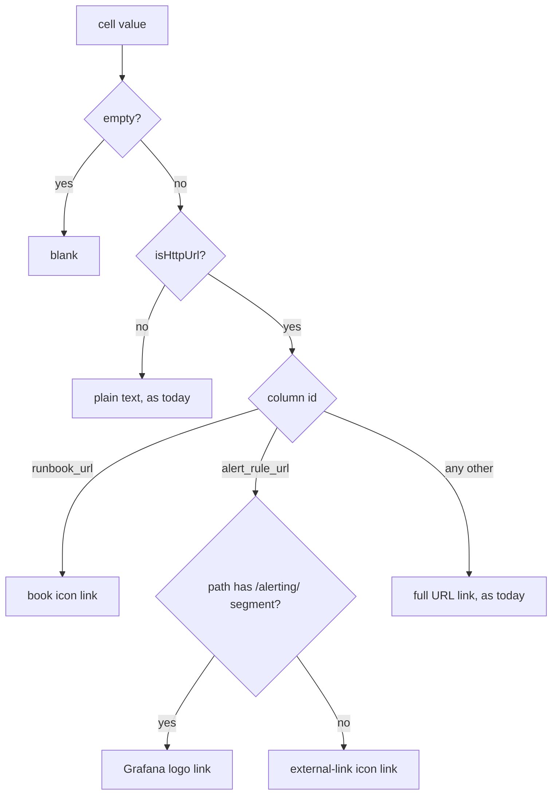

# Alert tables: rule and runbook links as icons

Status: draft, awaiting approval. Base: origin/dev `9e5b877e`. Repo: keep-ui only. Mock: variant A of "Rule & Runbook Links" (artifact `QPk1a8bCxVLiKJyAN6dSSZ`, 2026-11-16).

## Intro

### The problem

Alerts carry two links an on-call engineer needs while triaging:

- `alert_rule_url`: the Grafana alert rule that fired.
- `runbook_url`: the runbook for the alert.

The alert tables print each one as its full URL. A Grafana 12 rule link looks like `https://grafana-olly.com/alerting/grafana/aef3k2pq/view?orgId=1`. The column widens to fit the URL, so the two link columns take about 600px, which is more than the name and description columns together. On a dashboard widget that space is scarce, and the URL text tells the reader nothing the link itself doesn't.

Until ui#110 (merged to dev 2026-11-22), the dashboard Alert Table widget also showed these values as plain, unclickable text. Since #110 the widget builds its columns with the alerts-page `useAlertTableCols`, so on dev both tables render them as clickable full-URL links. The remaining problem is width and readability.

### Why we got this assignment

Users of the presets page and the dashboard Alert Table widget asked for clickable Grafana rule and runbook links that take less room. The team proposed replacing the Grafana link with a clickable Grafana icon. The 2026-11-16 mock offered three variants, and the user chose **variant A (icon only)** on 2026-11-24. The production Grafana is Grafana 12 Enterprise on the custom domain `grafana-olly.com`.

## Requirements

### Functional requirements

1. **Scope of columns.** The change applies to exactly two column ids: `alert_rule_url` and `runbook_url`. Every other URL-valued column (`url`, `generatorURL`, `ticket_url`, `playbook_url`, custom fields) keeps today's full-URL link.
2. **Rule link, Grafana.** When `alert_rule_url` is an http(s) URL whose path has an `alerting` segment (see "Grafana detection"), the cell shows the Grafana logo (`/icons/grafana-icon.png`, 16px) as a link.
3. **Rule link, not Grafana.** When `alert_rule_url` is an http(s) URL that doesn't match, the cell shows a generic external-link icon. A non-Grafana URL never shows the Grafana logo.
4. **Runbook link.** When `runbook_url` is an http(s) URL, the cell shows a book icon as a link.
5. **Opening.** Clicking an icon opens the URL in a new tab (`target="_blank"`, `rel="noopener noreferrer"`). It doesn't trigger the row click, so the alert sidebar doesn't open and widget quick actions don't fire. This matches today's link cell, which calls `stopPropagation`.
6. **Hover and focus.** The icon is a focusable anchor. Hover shows a tooltip with the action and the full URL: "Open alert rule in Grafana", "Open alert rule" or "Open runbook". The anchor's `aria-label` carries the same action text.
7. **Empty value.** `null`, `undefined` or `""` leaves the cell blank, as for every column today.
8. **Not a URL.** A value that isn't a valid http(s) URL (for example `see on-call wiki`, or a URL without a scheme) is shown as plain text, unchanged from today.
9. **Default headers.** The default headers become **"Rule"** and **"Runbook"** instead of "Alert Rule Url" and "Runbook Url". A rename the user sets (`columnRenameMapping`, on the presets page or in the widget) still wins.
10. **Width.** Both columns have a minimum width of 44px, so the column can shrink to the icon plus padding. Auto-fit measures the icon and header, not the URL.
11. **Column behaviour unchanged.** Both columns can still be shown, hidden, reordered, sorted, grouped and renamed on their own, on the presets page and in the widget.
12. **Dashboard edit mode.** In the widget, while the dashboard is in edit mode, the icon stays visible but dimmed and doesn't navigate. This matches how edit mode already turns off row clicks (`preset-alert-table-panel.tsx`).
13. **All tables that use `useAlertTableCols`** get the same cell: the presets page, the dashboard Alert Table widget, incident alerts, the alert history modal and the alert detail tab.

### Non-functional requirements

- **No backend change.** Both fields are already top-level `AlertDto` fields (`src/entities/alerts/model/types.ts:49-50`) in the gateway, event-handler and workflows.
- **No new dependencies.** The Grafana logo already ships at `public/icons/grafana-icon.png`. The book and external-link icons come from `react-icons/md`, which `alert-table-utils.tsx` already imports.
- **Performance.** No new requests. The renderer already parses each value with `new URL()` in `isHttpUrl`; the Grafana check reuses that parse. A widget at its row limit renders the same number of cells as today.
- **Security.** Only `http:`/`https:` URLs become links (the existing `isHttpUrl` guard), so `javascript:` and other schemes stay text. The `noopener noreferrer` behaviour is unchanged.
- **Dark mode.** Keep's dark mode is a page-wide `invert()` filter (`html.workaround-dark`). The Grafana PNG gets inverted exactly like the provider logos in the Source column. No special case.
- **Accessibility.** The icon anchors can be reached by keyboard and have an `aria-label`. The tooltip shows on focus as well as hover.
- **Backward compatibility.** No stored config changes. A column width the user already saved for these columns still applies; only the defaults and minimums change.

## Proposed Implementation

### Where the icon cell lives

**Option A: In the shared generated-column renderer.**
`useAlertTableCols` in `src/widgets/alerts-table/lib/alert-table-utils.tsx` already has an `isHttpUrl(value)` branch (line ~394) that renders the full-URL link. Ahead of it, add a branch keyed on `context.column.id` that renders a new `AlertLinkIconCell` component (`src/widgets/alerts-table/ui/alert-link-icon-cell.tsx`) for the two ids. The widget gets the change automatically: its `withGuardedCell` wrapper already handles empty values and then calls the shared cell.

Trade-offs:
- Pros: one change covers every alert table (requirement 13), and the presets page and widget can't drift apart again.
- Cons: tables other than the two named in the request also change, which is intended but widens what needs checking.
- Complexity / risk / cost / time: low. One new small component and one branch in the renderer.

**Option B: Widget-only wrapper.**
Wrap the two columns in `use-widget-alert-columns.ts`, like `withGuardedCell`, and leave the presets page as is.

Trade-offs:
- Pros: smallest blast radius.
- Cons: the presets page keeps the 600px link columns, which is half the request. It also brings back the per-surface drift that #110 just removed.
- Complexity / risk / cost / time: low, but it would need a second change later.

**Recommendation:** Option A. The request covers both tables, and after #110 the shared renderer is the one place that covers both.

### Grafana detection

Grafana 12 alert rule URLs, Grafana-managed and data-source-managed, all live under the `alerting` route:

- `https://grafana-olly.com/alerting/grafana/<rule-uid>/view?orgId=1`: the Grafana-managed rule view, and the form Grafana puts in a notification's rule link.
- `https://grafana-olly.com/alerting/<datasource-uid>/<rule-id>/view`: a data-source-managed rule.
- `https://grafana-olly.com/alerting/list?search=...`: the rule list, filtered.

**Option A: Path match.**
Show the Grafana logo when `new URL(value).pathname` contains an `/alerting/` segment. This works on any host and under a sub-path (`root_url` such as `/grafana/alerting/...`).

Trade-offs:
- Pros: no configuration, works for `grafana-olly.com` and any future Grafana host, and ships to every customer unchanged.
- Cons: a non-Grafana tool that also uses `/alerting/` paths would get the Grafana logo. In this deployment `alert_rule_url` only carries Grafana rule links, so the risk is small.
- Complexity / risk / cost / time: very low. A pure function with a unit test.

**Option B: Host allowlist from config.**
Match the URL origin against an env-configured list (for example reuse `GRAFANA_EMBED_ALLOWED_ORIGINS` from the Grafana Panel widget, or add a new `KEEP_GRAFANA_ORIGINS`).

Trade-offs:
- Pros: exact. Only the known Grafana hosts get the logo.
- Cons: the Grafana Panel allowlist means "may embed", and an empty list turns that widget off, so reusing it ties two unrelated settings together. A new env is one more ConfigMap value to maintain, and with it unset every rule link falls back to the generic icon. Hard-coding `grafana-olly.com` isn't an option, because keep-ui ships to other customers.
- Complexity / risk / cost / time: low code, ongoing ops cost.

**Recommendation:** Option A. It needs no configuration, and the path is the stable part of Grafana 12 rule links, while the host varies per customer. Option B can be added later if a non-Grafana source starts filling `alert_rule_url`.

### Headers and width

There is one viable approach.

- **Headers, presets page.** Generated columns get their header from `getColumnDisplayName(colName, colName, columnRenameMapping)`, which falls back to `startCase(colName)`. For the two ids, pass a short default name instead of `colName`, from a small `LINK_ICON_COLUMNS` map (`alert_rule_url → "Rule"`, `runbook_url → "Runbook"`). A rename still wins, because `columnRenameMapping` is checked first.
- **Headers, widget.** The widget ignores that header and uses `getColumnLabel` (`alert-column-options.ts`), which falls back to its own `COLUMN_LABELS` map and then `startCase`. Add the same two entries to `COLUMN_LABELS`, read from the one `LINK_ICON_COLUMNS` map so the two tables can't disagree. Because the widget settings (column list, rename, count-by and group-by lists) label fields with `getColumnLabel`, those lists show "Rule" and "Runbook" too. Checking a rename against the default (`widget-table-settings.tsx:313`) keeps working, since both sides call `getColumnLabel`.
- **Presets column picker.** The presets page's column picker keeps listing the raw field names (`alert_rule_url`, `runbook_url`), unchanged.
- **Width.** Add `linkIcon: { min: 44, max: 120 }` to `ALERT_COLUMN_SIZE` (`alert-table-column-consts.ts`) and use it as the `minSize`/`maxSize` of the two generated columns instead of `generated` (100–800). In the widget, `atMinimumSize` already starts columns at `minSize`, so they open at 44px. Auto-fit (`column-autofit.ts`) measures the rendered cell and the header, so it fits the icon and the word "Runbook".

**Recommendation:** go with the above. The rejected alternative, a CSS-only shrink that hides URL text, would keep the long default headers holding the column open.

### Edit-mode behaviour in the widget

**Option A: Table meta flag.**
The widget table sets `meta.linksDisabled = isEditMode`. This is the same `table.options.meta` channel the renderer already reads for `columnTimeFormats` and `columnListFormats`. With the flag set, `AlertLinkIconCell` renders a dimmed, non-navigating icon (`aria-disabled`, no `href`).

Trade-offs:
- Pros: explicit, testable, and other tables are untouched because they never set the flag.
- Cons: one more meta field.
- Complexity / risk / cost / time: very low.

**Option B: Leave links live in edit mode.**

Trade-offs:
- Pros: zero work.
- Cons: a click while arranging widgets opens a new tab mid-edit. It's also inconsistent with row clicks, which edit mode already turns off.
- Complexity / risk / cost / time: none.

**Recommendation:** Option A. It's what the approved mock shows, and it matches edit mode's existing "no navigation" rule.

### Tests

- `alert-table-utils.test.tsx`: cell output for each state: Grafana rule URL → logo link; other rule URL → external icon; runbook URL → book link; empty → blank; non-URL text → plain text; `javascript:` → plain text; a renamed header overrides "Rule"; other URL columns still render the full URL.
- A unit test for the Grafana matcher covering the three Grafana 12 URL forms above, a sub-path install, and a non-Grafana URL.
- `widget-alerts-table.test.tsx`: icons render in the widget, clicking doesn't fire the row handler, and edit mode renders the icon without `href`.
- Before marking done: `npm run typecheck`, `npm run lint` and the touched Jest files, then a browser check of the presets page and a dashboard widget in light and dark mode.

## Summary

- **Chosen approach:** Variant A. In every alert table, `alert_rule_url` shows a Grafana logo link (or a generic link icon for non-Grafana URLs) and `runbook_url` shows a book icon link. The columns are 44px wide by default with headers "Rule" and "Runbook". It's one change in the shared `useAlertTableCols` renderer, in keep-ui only.
- **Key decisions:**
  - Shared renderer, not widget-only, because #110 made it the single source for both tables.
  - Grafana is detected by the `/alerting/` path, not by host, so no config is needed and it works on `grafana-olly.com` and for other customers.
  - Both columns stay separate, so each can still be hidden, sorted, grouped and renamed.
  - Links don't navigate in dashboard edit mode.
- **Out of scope / follow-ups:**
  - Other URL columns (`url`, `generatorURL`, `ticket_url`, `playbook_url`) keep full-URL links; they can get icons later using the same component.
  - Values without an `http(s)://` scheme stay plain text. If production rule links turn out to be stored without a scheme, that needs its own decision (whether to add `https://`).
  - A host-based Grafana allowlist (Option B above), only if a non-Grafana source starts filling `alert_rule_url`.
